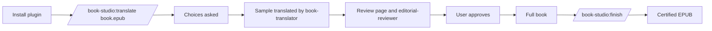

# Book Studio Core — Agent-host integration (UX)

> Feature master: read this file first. The rules live in `logic/agent-host-integration.md`.

## Purpose

- Problem: translating a book inside Claude Code or Codex should feel native, with commands, specialised helpers and
  guard rails, without a second copy of the engine.
- Audience: a person translating a book for private reading in Claude Code (CLI, the desktop Code tab, VS Code) or
  Codex.
- Success signal: install with two commands. `/book-studio:translate <book>` leads to a reviewed sample, and the agent
  cannot edit the certified EPUB behind the gate.

## Scope

- Included: one plugin folder with a Codex manifest and a Claude manifest. It ships:
  - the `book-translation` skill;
  - commands `/book-studio:start` (job menu: translate, bilingual, restyle, PDF to EPUB, fix formatting, edit a
    finished book; then only that job's questions), `/book-studio:translate`, `:review`, `:finish` and `:capture`;
  - agents `book-translator` (one packet in an isolated context) and `editorial-reviewer` (read-only);
  - hooks (guard, session status);
  - an MCP server with 14 tools and an experimental MCP Apps review view;
  - the optional `projects_dir` setting;
  - an eval suite.
- Also included: `bookstudio install --host <cursor|antigravity|kimi|opencode>` for other AI tools (skill + MCP
  server, no commands, agents, hooks or chat view), and Windows through the same Python engine.
- Excluded: claude.ai web chat, which would upload the book to a cloud sandbox.

## Current truth

- Claude install:
  `claude plugin marketplace add wblekhoa/book-studio-core#v0.4.0`, then
  `claude plugin install book-studio@book-studio`. The in-session form is `/plugin marketplace add …` then
  `/plugin install …`.
- Codex install is unchanged. Codex ignores the Claude-only files; a Codex run with the plugin installed showed no
  errors.
- Always-on cost in Claude is about 294 tokens per session (`claude plugin details book-studio`).

## Other AI tools

1. Install Python 3.11+ (Windows: from python.org, tick "Add to PATH"; `py` works too).
2. Download and unpack the release, then run one command (Windows uses `py`, macOS/Linux `python3`):
   `py plugins\book-studio\scripts\bookstudio.py install --host cursor` (or `antigravity`, `kimi`, `opencode`).
   `--dry-run --json` shows the plan first; `uninstall --host …` undoes it.
3. Restart the tool and ask it to translate a book. The agent reads the skill and calls the `book-studio` tools.

| Host        | Skill folder                      | Config written                          |
| ----------- | --------------------------------- | --------------------------------------- |
| Cursor      | `~/.cursor/skills/`               | `~/.cursor/mcp.json`                    |
| Antigravity | `~/.gemini/antigravity/skills/`   | `~/.gemini/antigravity/mcp_config.json` |
| Kimi Code   | `~/.kimi-code/skills/`            | `~/.kimi-code/mcp.json`                 |
| OpenCode    | `~/.config/opencode/skills/`      | `~/.config/opencode/opencode.json`      |

The person sees one line per part (engine, skill, MCP: installed / updated / unchanged) and the backup path.
Refusals name the file and leave it untouched.

## Screens and states

| Surface             | What the person sees                                                                 |
| ------------------- | ------------------------------------------------------------------------------------ |
| Session start       | "Book Studio projects nearby" with stage, progress and next command, when projects exist |
| Blocked write       | A denial that names the file and points to `edits.json` + `finish`                   |
| `/book-studio:review` | A stage and progress summary, plus the path to `reports/review.html`                 |
| MCP review tool     | The review page inside the chat where the host supports MCP Apps; otherwise text    |

## Flow

## Reading order

| File                                  | Role            |
| ------------------------------------- | --------------- |
| this file                             | current truth   |
| `logic/agent-host-integration.md`     | rules + REQ-IDs |
| `docs/claude-plugin.md`               | install and maintenance |

## Change log

- 2026-10-13: created.

## Chat-first workspace (0.4.0)

See `chat-workflow.md`. The new Mods adapter shows saved progress within the conversation; MCP Apps-compatible
hosts can show the source/sample and refresh status. Decisions remain chat messages. Native adapter tests and a
browser bridge probe passed; actual desktop installs/renders remain unverified. No browser or dashboard is required.
