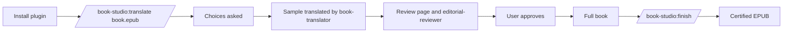

# Book Studio Core — Agent-host integration (UX)

> Feature master: read this file first. The rules live in `logic/agent-host-integration.md`.

## Purpose

- Problem: translating a book inside Claude Code or Codex should feel native, with commands, specialised helpers and
  guard rails, without a second copy of the engine.
- Audience: a person translating a book for private reading in Claude Code (CLI, the desktop Code tab, VS Code) or
  Codex.
- Success signal: install with two commands. `/book-studio:translate <book>` leads to a reviewed sample, and the agent
  cannot edit the certified EPUB behind the gate.

## Scope

- Included: one plugin folder with a Codex manifest and a Claude manifest. It ships:
  - the `book-translation` skill;
  - commands `/book-studio:translate`, `:review`, `:finish` and `:capture`;
  - agents `book-translator` (one packet in an isolated context) and `editorial-reviewer` (read-only);
  - hooks (guard, session status);
  - an MCP server with 11 tools and an experimental MCP Apps review view;
  - the optional `projects_dir` setting;
  - an eval suite.
- Excluded: claude.ai web chat, which would upload the book to a cloud sandbox, and Windows.

## Current truth

- Claude install:
  `claude plugin marketplace add wblekhoa/book-studio-core#v0.3.0`, then
  `claude plugin install book-studio@book-studio`. The in-session form is `/plugin marketplace add …` then
  `/plugin install …`.
- Codex install is unchanged. Codex ignores the Claude-only files; a Codex run with the plugin installed showed no
  errors.
- Always-on cost in Claude is about 294 tokens per session (`claude plugin details book-studio`).

## Screens and states

| Surface             | What the person sees                                                                 |
| ------------------- | ------------------------------------------------------------------------------------ |
| Session start       | "Book Studio projects nearby" with stage, progress and next command, when projects exist |
| Blocked write       | A denial that names the file and points to `edits.json` + `finish`                   |
| `/book-studio:review` | A stage and progress summary, plus the path to `reports/review.html`                 |
| MCP review tool     | The review page inside the chat where the host supports MCP Apps; otherwise text    |

## Flow

## Reading order

| File                                  | Role            |
| ------------------------------------- | --------------- |
| this file                             | current truth   |
| `logic/agent-host-integration.md`     | rules + REQ-IDs |
| `docs/claude-plugin.md`               | install and maintenance |

## Change log

- 2026-10-13: created.
