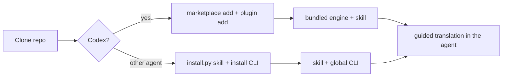

# Book Studio Core — Portable skill and Codex plugin (UX)

> Feature master: read this file first to understand how an AI agent gets Book Studio. Rules live in
> `logic/portable-skill.md`; install and troubleshooting steps are in `README.md` and `docs/codex-plugin.md`.

## Purpose

- Problem: the CLI alone does not hold the conversational and editorial know-how - asking about missing choices,
  proposing a pilot, reviewing quality - and installing a Python CLI is a barrier for many readers.
- Audience: a reader using Codex (plugin) or any agent that supports directory-based skills (standalone skill).
- Success signal: after one install the reader can say "help me translate this book" and the agent runs the guided
  workflow with the matching engine.

## Scope

- Included: the Codex plugin with its bundled engine, the standalone `book-translation` skill and its installer, and
  the generator that keeps the plugin in step with the sources.
- Excluded: the engine's behaviour (`ux/translation-pipeline.md`, `ux/guided-pilot.md`); AI providers, OCR, Poppler and
  renderers, none of which are bundled.

## Current truth

- **Codex plugin**: clone the repo, `codex plugin marketplace add .`, `codex plugin add book-studio@book-studio`, start
  a new thread and pick Book Studio. The plugin carries its own copy of the engine and runs it with the reader's
  Python 3.11+, so no pip, API key or separate CLI is needed.
- **Standalone skill**: `python3 skills/book-translation/scripts/install.py` installs the skill; `--dry-run` previews,
  `--check` reports `current`, `missing` or stale. An update keeps a timestamped backup and verifies an exact copy
  before reporting success. The CLI is installed separately in this form.
- The skill drives intake, the pilot, the packet loop and final audits (editorial receipt and final-EPUB audit
  scripts), but never bypasses the CLI's safety gates and never contains book content.
- Maintainers regenerate the plugin with `python3 scripts/build_plugin.py`; CI fails if the bundle differs from the
  sources.

## Screens and states

| Screen                           | States                                         | Entry                    | Exit / next                       |
| -------------------------------- | ---------------------------------------------- | ------------------------ | --------------------------------- |
| Codex plugin install             | installed · Codex configuration error          | cloned checkout          | new thread, select Book Studio    |
| `install.py` (skill)             | installed · current · missing · would update · restored after failure | cloned checkout | agent loads `$book-translation` |
| `build_plugin.py --check` (maintainer) | matches · drift                          | source change            | regenerate, commit                |

## Flow

## Reading order

| File                        | Role                                  |
| --------------------------- | ------------------------------------- |
| this file                   | current truth                         |
| `logic/portable-skill.md`   | rules + REQ-IDs                       |
| `docs/codex-plugin.md`      | plugin install, update, troubleshooting |
| `skills/book-translation/SKILL.md` | the skill itself               |

## Change log

- 2026-10-11: created.
