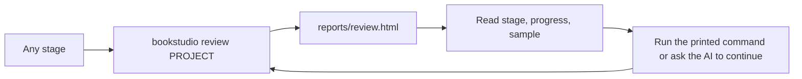

# Book Studio Core — Review page (UX)

> Feature master: read this file first to understand the current behaviour of the review page. The rules live in
> `logic/review-page.md`.

## Purpose

- Problem: reviewing the sample and checking progress in a terminal or chat is slow and easy to misread.
- Audience: a person translating a book for private reading, with or without an AI agent.
- Success signal: a person can see the stage, the progress, the sample, and the next step without reading JSON.

## Scope

- Included: one static page per project at `reports/review.html`, generated by `bookstudio review PROJECT` (or the
  plugin's runner).
- Excluded: editing, approving, or revising from the page. Those remain CLI commands, and the page prints the exact
  command. Also excluded: hosting or sharing the page, and images.

## Current truth

- The page is generated on demand and is a snapshot. The person reruns the command to refresh it.
- It works offline in any browser, in light and dark mode, and down to phone width without horizontal scrolling.
- The interface text is English. Book text appears in its own language, with `lang` attributes set.

## Screens and states

| Section             | Content                                                                 | Empty state                               |
| ------------------- | ----------------------------------------------------------------------- | ----------------------------------------- |
| Where the project is | stage chips (Choices → Sample proposed → Sample in translation → Sample review → Full book → Finished), a one-line hint, the next command | expert projects show one "Expert project" chip |
| Progress            | coverage bar, translated / eligible / remaining, per-document table, source-hash mismatch warning | "Coverage is not available yet"            |
| Sample chapter      | source and translation pairs with a block number, role, and state badge (Translated / Not translated yet / Source changed) | "No sample blocks to show yet" |
| Choices             | the locked intake answers, or the `bookstudio.toml` profile for expert projects | "No recorded choices"                      |
| Final book          | output path, reproducible, integrity, SHA-256, and whether the file still matches the gate | "The final gate has not run yet"          |

## Flow

## Reading order

| File                      | Role                     |
| ------------------------- | ------------------------ |
| this file                 | current truth            |
| `logic/review-page.md`    | rules + REQ-IDs          |
| `ux/guided-pilot.md`      | the lifecycle it reports |

## Change log

- 2026-10-13: created. The first version is read-only static HTML.
