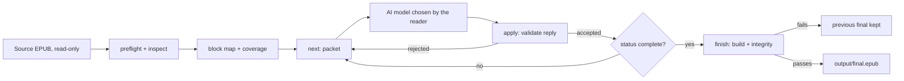

# Book Studio Core — Translation pipeline (UX)

> Feature master: read this file first to understand how a book moves from source EPUB to translated EPUB. Rules live
> in `logic/translation-pipeline.md`; engineering contracts in `docs/architecture.md`, `docs/ai-packets.md` and
> `docs/safety.md`.

## Purpose

- Problem: translating a whole book with an AI loses structure, consistency and any proof of what was translated.
- Audience: the reader driving a private translation, usually through an AI agent that calls the CLI.
- Success signal: the finished EPUB opens with working navigation, links and images, and every translated block traces
  back to one source block.

## Scope

- Included: archive preflight and inspection, the stable block map and coverage file, the `next` / `apply` packet
  loop, cache and status, `build` and `finish` for target-only and bilingual output, image annotations and companions.
- Excluded: the intake conversation and pilot gate (`ux/guided-pilot.md`), PDF preparation (`docs/pdf-source-preparation.md`),
  agent packaging (`ux/portable-skill.md`).

## Current truth

- The surface is a command line with two audiences: `--json` for an AI caller (stable codes and exit codes) and plain
  text with a "Next action" line for a person.
- The source EPUB is opened read-only and never changed. Everything the workflow writes goes to a private project
  folder outside this repository.
- `next PROJECT --json` returns one packet: blocks from one source document, neighbouring context the model must not
  translate, matched glossary terms, chapter reference notes and the exact response schema. The engine never calls a
  model; the agent sends the packet to whatever model the reader chose and saves the reply as JSON.
- `apply PROJECT RESPONSE --json` validates that reply - shape, hashes, packet freshness, safe inline XHTML, image
  rules - and only then appends it to the cache. A rejected reply changes nothing and returns a code that says what to
  fix.
- `status` exits 2 while work remains and 0 when coverage is complete; `next` exits 3 when nothing is left.
- `finish` builds a candidate, checks integrity and reproducibility, and only then replaces `output/final.epub`.
  Target-only output translates titles and navigation labels; bilingual output shows source and translation together.

## Screens and states

| Screen (CLI step)  | States                                   | Entry                         | Exit / next                         |
| ------------------ | ---------------------------------------- | ----------------------------- | ----------------------------------- |
| `inspect`/`prepare` | ok · unsafe archive · broken EPUB        | source EPUB path              | block map + coverage in the project |
| `next`             | packet (exit 0) · no work (exit 3) · blocked by pilot (exit 2) | prepared project | agent translates the packet         |
| `apply`            | applied · rejected with code             | response JSON file            | `next` again                        |
| `status`           | incomplete (exit 2) · complete (exit 0)  | any time                      | `finish` when complete              |
| `finish`           | final written · integrity failed         | complete coverage             | `output/final.epub`                 |

## Flow

## Reading order

| File                              | Role                                        |
| --------------------------------- | ------------------------------------------- |
| this file                         | current truth                               |
| `logic/translation-pipeline.md`   | rules + REQ-IDs                             |
| `docs/ai-packets.md`              | packet and response contract (engineering)  |
| `docs/safety.md`                  | filesystem, archive and XHTML safety model  |

## Change log

- 2026-10-11: created.
